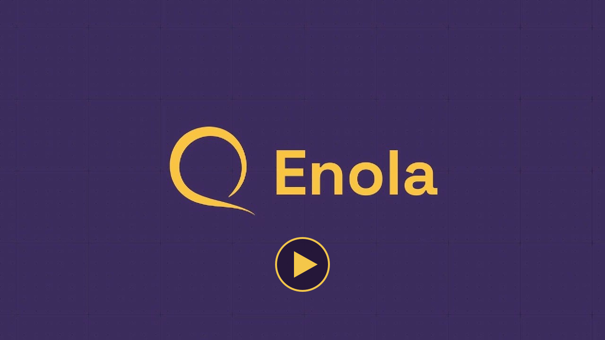

<div align="center">

  <h1><a href="https://enola.tech"><picture>
    <source media="(prefers-color-scheme: dark)" srcset="docs/images/enola-wordmark-dark.svg" />
    
  </picture></a></h1>

  <p><strong>A code graph and architecture check for your whole software system, with an MCP server for coding agents.</strong><br />
  Built from the code, on your machine.</p>

  <p align="center">
  <a href="https://enola.tech">enola.tech</a>
  ·
  <a href="docs/README.md">Docs</a>
  ·
  <a href="docs/CLI.md">CLI reference</a>
  ·
  <a href="docs/BENCHMARKS.md">Benchmarks</a>
  ·
  <a href="https://github.com/enola-labs/enola/releases">Releases</a>
  ·
  <a href="https://github.com/enola-labs/enola/issues">Report a gap</a>
  </p>

  <p>
  <a href="https://github.com/enola-labs/enola/actions/workflows/ci.yml"></a>
  <a href="https://github.com/enola-labs/enola/releases"></a>
  <a href="LICENSE"></a>
  <a href="https://github.com/enola-labs/enola/stargazers"></a>
  <a href="https://mcptoplist.com/server/glama%2Fenola-labs%2Fenola"></a>
  </p>

  <p><strong>Other code-graph tools index your code. enola compiles it.</strong><br />
  It resolves every import, call, route and database table to what it really refers to, links your services where one calls another, and checks the result: what a change breaks, what nothing uses, where the architecture drifts. Your coding agent gets answers, not source to reason over.</p>

  <p><strong>One binary. No AI model, no account, no upload.</strong><br />
  Kubernetes indexes in 14 seconds, 6.5 once cached. 100 repositories, the Linux kernel among them, link into one graph in under 5 minutes.</p>

<p align="center">
  <a href="https://www.youtube.com/watch?v=xytpfmlUD6U"></a>
</p>
</div>

## What it does for you

Most of this you ask your coding agent in plain words, once enola is [connected](#connect-your-agent). The agent picks the tool or [skill](docs/SKILLS.md) and answers from the graph instead of from text searches.

| When you… | Ask or run | You get |
| --- | --- | --- |
| are about to change shared code | "What breaks if I change `X`?" | Every place that depends on it, directly or through other packages, and the endpoints it affects. [Impact](docs/CLI.md#the-twenty-four-tools) |
| review a pull request | "Review this branch against main" | What the change did to the structure, and up to five places a reviewer should look, each with the reason. `--reviewers` adds who owns what it touched. [Review skill](docs/SKILLS.md#review) |
| need to test a change | "What should be tested for this change?" | The tests that reach it, nearest first, the entry points to exercise, and the changed code no test reaches. [Test-plan skill](docs/SKILLS.md#test-plan) |
| want the architecture to hold | "Set up architecture rules for this repository" | Rules the code already almost follows, proposed for you to accept, then checked on every change, by your agent and in CI. [Intent skill](docs/SKILLS.md#intent), [Grade a change](#grade-a-change) |
| keep notes or agent memory about code | "Which of our notes still hold?" | Each note tied to the code it describes, and marked current, moved, changed or gone when that code moves on. [Memory skill](docs/SKILLS.md#memory) |
| open a repository you do not know | `enola --explain --summary`, `enola flows` | What the repository is, its ways in, what is risky to change and where to start reading. [Quickstart](#quickstart) |
| want to clean up | "What does nothing use?" | Dead code, backend routes no client calls, and database queries run once per loop iteration. [Explainers](docs/EXPLAINERS.md) |
| wonder when something got in | `enola blame "pkg/a -> pkg/b"` | The commit where a dependency, a cycle or a symbol entered the architecture, and when it left. [History](docs/HISTORY.md) |
| work across services | "Who calls `/api/orders`?" | The callers in the other repositories, and the screens behind them. [Across repositories](#across-repositories) |
| want one graph for the whole company | `enola serve` | Every repository linked into one graph, served over HTTP to your agents, portal or review bot, with tokens, confined roots and an audit log. [Serving](docs/SERVING.md) |
| build your own tooling | `enola --generate` | Plain files in a documented format, ready to load anywhere. [Build on the graph](#build-on-the-graph) |

New here? Start with the [Quickstart](#quickstart), or follow [one graded change end to end](docs/FIRST-CHANGE.md).

## Indexing versus compiling

Code-graph tools such as Graphify, CodeGraph and codebase-memory-mcp index code for retrieval: they store symbols and source, joined by name, and hand them to your agent to work out the answer. enola treats the code as a program to resolve, the way a compiler does, and computes the answer itself.

The difference shows on a single endpoint. A web app calls `GET /api/v2/orders/{id}`. The API never writes that string: `/api/v2` is a prefix set in `main()`, and `/orders/{id}` is registered in another function. An index finds `/orders/{id}` and stops. enola follows the prefix the way a compiler follows a call, and links the web app's request to the handler that serves it.

| | Indexing tools | enola |
| --- | --- | --- |
| Reads code as | text and syntax trees, matched by name | a program: imports, calls and routes resolved to what they point at |
| A route is | the string written in one file | the address it answers on, prefix and method included |
| Across repositories | joined where names or paths match as written | linked where one side calls the other |
| Your agent gets | source to read and reason over | the answer: what breaks, what is unused, what a change did |
| The graph is | a store kept current as files change | a snapshot with an ID: the same code gives the same graph, so a change can be graded against a baseline |

## Quickstart

**1. Install enola.** One prebuilt binary; no Go toolchain or C compiler needed.

```bash
curl -fsSL https://raw.githubusercontent.com/enola-labs/enola/main/install.sh | sh
```

This puts `enola` in `~/.local/bin`. The same binary is on PyPI (`pip install enola-cli`) and RubyGems. Every install route is in [docs/CLI.md](docs/CLI.md#install).

**2. Read a repository you have checked out.** No config file, no account, nothing written to disk:

```bash
enola --explain --summary /path/to/your/repo
```

It says what the repository is, whether its structure holds, where to start reading and what is risky to change, and marks each statement with how sure enola is. Part of what it prints for enola itself (the numbers move as the code does):

```
Structure: healthy
  No circular dependencies, and no layer rule broken.

Careful when changing
  github.com/enola-labs/enola/internal/facts
    A change here can reach 127 other folders of code within three import
    steps. Have tests in place before changing it.
```

Drop `--summary` for the full report with every check's numbers; the terms it uses are in the [glossary](docs/GLOSSARY.md).

**3. Connect your coding agent.** In the repository:

```bash
enola install --hooks
claude mcp add-json enola '{"command":"enola","alwaysLoad":true}'
```

The first line tells Claude Code, Codex, Cursor, Copilot, opencode and Pi that enola exists, adds its [skills](docs/SKILLS.md), and with `--hooks` grades each agent session. It previews every file it changes and asks first. The second registers the MCP server for Claude Code; other clients are one line each in [Connect your agent](#connect-your-agent). Then ask the agent something only the graph answers well:

> What breaks if I change `OrderService.cancel`?

**4. Change code with your agent, then review it.** The hooks grade every turn: if the agent's edit adds a dependency cycle or crosses a layer, it is told before it says it is done. When the work is finished, ask for a review:

> Review my changes against main.

or call the skill by name: `/enola-review` in Claude Code (`/enola:review` with the plugin, `$enola-review` in Codex). You get what the change did to the structure and where a reviewer should look. Without an agent, the same check is `enola baseline pin`, then your edit, then `enola check`; see [Grade a change](#grade-a-change) and [Use it in CI](#use-it-in-ci).

**5. If your agent keeps memory, stamp it once.** Run `/enola-memory` with no task. It ties each note about code to the code it describes, and lists the notes whose code was renamed or deleted since. To keep new notes stamped, add one line to the agent's instructions: "stamp notes about code with enola-memory". [Memory skill](docs/SKILLS.md#memory).

**6. Stay current.**

```bash
enola upgrade
enola install
```

`enola upgrade` replaces the binary in place. Run `enola install` again afterwards in each repository you set up: a new release can change hooks or skills, and only `install` writes them. No flags are needed: hooks an earlier install wrote are kept, and `--no-hooks` removes them. Then restart your agent session so its MCP server runs the new binary. `enola doctor` lists any skill an older version wrote. [Upgrading in detail](docs/CLI.md#upgrade).

To keep the graph and browse it, `enola --generate .` saves it under `.enola/` and `enola dashboard --open` shows it in a local web page. [Dashboard guide](docs/DASHBOARD.md).

## How enola works

enola parses each source file, turns what it finds into typed facts, links the facts into a graph, and runs checks over the graph: dependency cycles, layer violations, unused routes, hotspots and more. Each check is called an **explainer**, and [docs/EXPLAINERS.md](docs/EXPLAINERS.md) describes every one of them.

| Command | What it does | Learn more |
| --- | --- | --- |
| `enola --explain <repo>` | Read a repository and print a report. Writes nothing. | [CLI reference](docs/CLI.md#explain-a-repository-at-a-glance) |
| `enola --explain --summary <repo>` | The same reading, as a short plain-language summary. | [CLI reference](docs/CLI.md#plain-language-summary) |
| `enola --generate <repo>` | Build the graph and save it under `.enola/` as a snapshot. | [The graph](docs/GRAPH.md) |
| `enola baseline pin` | Record the current state of the graph as the point to compare against. | [Gating a change](docs/GATING.md) |
| `enola check` | Build the graph again and report only what changed since the pin. | [Gating a change](docs/GATING.md) |
| `enola coverage <cluster>` | For several repositories, say which cross-repository calls were linked and which could not be. | [Clusters](docs/CLUSTERS.md) |
| `enola dashboard --open` | Show the saved graph in a local web page. | [Dashboard guide](docs/DASHBOARD.md) |
| `enola install --hooks` | Tell your coding agents enola exists and grade each of their sessions. | [Connect your agent](#connect-your-agent) |

Three properties hold for all of it:

- **Deterministic.** The same code always gives the same graph. 91 open-source repositories indexed three times each (once cold, twice warm) gave byte-identical results, over 8.1 million facts. Every snapshot carries a **receipt**: a record of exactly how it was built. enola refuses to compare two snapshots that were not built the same way.
- **Fast enough for every commit.** Re-indexing an unchanged tree took 4.8s for grafana and 41.5s for the Linux kernel.
- **Local.** One binary reading local files. No model, no embeddings, no upload.

What the graph contains and what it writes to disk: [docs/GRAPH.md](docs/GRAPH.md). The numbers above and the scripts that produce them: [docs/BENCHMARKS.md](docs/BENCHMARKS.md). Internals: [ARCHITECTURE.md](ARCHITECTURE.md).

## Grade a change

The simplest way to see what changed is to check what came in with a pull. Record the current state, pull, and compare:

```bash
enola baseline pin
git pull
enola check
```

`enola check` builds the graph again and reports only what changed since the pin: new dependencies, new calls, new findings. Problems the repository already had stay out of the report. Your own edits work the same way: pin, change, check.

Here a new helper in `storage` imports the delivery layer. It compiles, every test passes, and it breaks the layer order the repository declared:

```
FAIL — 1 structural regression introduced.

Regressions (fail):
  - [layers] 1.00 — Layer violation: storage -> delivery
      import of notify
```

<p align="center">
  
</p>

A **regression** is something the change made worse compared with the pin. Some checks grade against how you say your system should look, such as a layer order or which service may call which. You write that down in [docs/INTENT.md](docs/INTENT.md) and [docs/CONSTRAINTS.md](docs/CONSTRAINTS.md).

Nothing fails by default. You choose what should, for example `enola check --fail-on=layers`. [docs/GATING.md](docs/GATING.md) explains what can fail a build and why; [docs/HISTORY.md](docs/HISTORY.md) covers how the architecture changed over time. The whole loop on a module small enough to read in a minute: [docs/FIRST-CHANGE.md](docs/FIRST-CHANGE.md).

## Use it in CI

The same check runs on every pull request with [enola-action](https://github.com/enola-labs/enola-action). It resolves the exact base commit, grades both sides on the runner, annotates the lines that introduced a finding, and writes the architecture delta to the job summary:

```yaml
- uses: actions/checkout@v7
  with:
    fetch-depth: 0
- uses: enola-labs/enola-action@v2   # reports only; add fail-on to gate
```

Same explainers and same exit codes as `enola check` in your shell, with no baseline to publish or restore. A ready workflow file is in [`examples/ci/`](examples/ci/).

## Connect your agent

First tell your agents enola exists, and let it grade each session:

```bash
enola install --hooks
```

Then give the agent the graph over **MCP** (Model Context Protocol: the standard way a coding agent calls an outside tool):

| Client | Do this |
|---|---|
| **Claude Code** | `claude mcp add-json enola '{"command":"enola","alwaysLoad":true}'` |
| **Codex** | `codex mcp add enola -- enola` |
| **Copilot (VS Code)** | `code --add-mcp '{"name":"enola","command":"enola"}'` |
| **Cursor** | add the block below to `.cursor/mcp.json` (or `~/.cursor/mcp.json` for every project) |
| **opencode** | nothing, `enola install` already registered it |
| **Pi** | nothing, `enola install` wrote an extension that serves the tools (Pi has no MCP client); trust the project in Pi, or use `--global` |
| **Any other MCP client** | add the block below to its MCP config |

```json
{ "mcpServers": { "enola": { "command": "enola" } } }
```

What changes for the agent: before an edit, it asks the graph what depends on the code it is about to touch, instead of piecing that together from text searches. After the edit, a **hook** (a command the agent runs automatically at the end of its turn) runs the same `enola check` as above. The agent sees what it actually changed and fixes a regression before telling you it is done.

`enola install` also gives the agent skills for whole tasks: reviewing a branch, planning what to test, setting up architecture rules, and keeping notes tied to the code they describe. Ask for the task ("review this branch against main") and the agent loads the skill, or call one by name. [docs/SKILLS.md](docs/SKILLS.md) covers each skill, the Claude Code plugin, and how to call them in every agent.

On Claude Code you can use the plugin instead of `enola install`: `/plugin marketplace add enola-labs/enola`, then `/plugin install enola@enola`. It registers the MCP server, the hooks and the skills; use one route or the other, not both.

`enola install` previews every file it changes and asks first; `enola uninstall` reverses all of it. `enola doctor` tells you whether the hooks are really firing. Per-client details, including Copilot's different config key: [docs/CLI.md](docs/CLI.md#connect-it-to-your-agent).

## Across repositories

A system rarely lives in one repository, so enola does not stop at one. Give it a backend and the things that call it (a web app, a mobile app, another service) and it links them into one graph. Then it can answer: *if I change this endpoint, what breaks?*

The hard part is that two sides rarely spell an endpoint the same way. In [`examples/cross-repo/`](examples/cross-repo/) the web service calls `/api/v2/orders/{id}`, but the API service never writes that string anywhere:

```go
v2 := r.PathPrefix("/api/v2").Subrouter()
registerOrders(v2)                        // in main()

r.HandleFunc("/orders/{id}", getOrder)    // in registerOrders(), a different function
```

enola follows the prefix into the function it was passed to and files the route under the address it actually answers on, so the call links. It does the same for Express, FastAPI, Axum, Rails and Swift, where the prefix often sits in another file entirely.

When it *cannot* link something, it says so instead of guessing:

```
$ enola coverage cluster.yaml

  service  classification  detected  resolved  unresolved
  api      isolated              0         0           0
  web      connected             3         2           1
```

The unresolved call builds its URL at runtime, so there is nothing to match. That distinction matters: a service with no connections and a service whose connections enola failed to follow should never look the same. The example runs in one command: `./run.sh`. How several repositories are described and matched: [docs/CLUSTERS.md](docs/CLUSTERS.md).

## Build on the graph

A **snapshot** is a set of plain files with a [documented format](docs/schema/README.md): the facts, the relationships between them, the findings, and a receipt recording exactly how it was built. Run enola as a subprocess and load those files wherever you need them.

[Cognee](https://github.com/topoteretes/cognee) builds its code-graph search this way: it pins an `enola-cli` release and loads the snapshot files, and that search needs no LLM key. How it finds the binary and what it writes: [docs/INTEGRATING.md](docs/INTEGRATING.md#cognee). If you got enola as part of Cognee, [docs/COGNEE.md](docs/COGNEE.md) shows where the binary is and how to use it directly.

[docs/GRAPH.md](docs/GRAPH.md) explains what the graph contains and which files are a stable contract; [docs/INTEGRATING.md](docs/INTEGRATING.md) shows how to load it step by step.

## What it reads

More than twenty languages and formats, detected automatically. A repository with two languages is indexed as two languages without being told.

- **Application code:** Go, Java, Kotlin, Scala, JavaScript, TypeScript, Vue, Svelte, Ember, Angular, Python, Ruby, PHP, Swift, Dart/Flutter, Rust, C/C++, .NET (C#, VB.NET, F#)
- **APIs and messaging:** OpenAPI, gRPC, GraphQL, AsyncAPI
- **Infrastructure:** Terraform/HCL, Ansible, Kubernetes manifests and kustomize, Helm charts

On top of the language it understands the frameworks that shape routes, storage and wiring, among them Rails, Django, FastAPI, Spring, Express, Next.js, ASP.NET Core, Laravel, Axum, SwiftUI and Jetpack Compose. The full table is in [docs/LANGUAGES.md](docs/LANGUAGES.md). A language you do not see there is a gap worth [reporting](https://github.com/enola-labs/enola/issues).

## Explore examples

Each example is a small repository plus a `run.sh` that reproduces the output shown in its README.

- [The gate on five packages](examples/layers-gate/): a module built to a layer order, and one change that breaks it. This is the fixture the outputs in this README come from.
- [Two repositories, one graph](examples/cross-repo/): a web service and the API it calls, with one call enola can link and one it reports as unresolved.
- [Policy as code](examples/policy-as-code/): PCI DSS and GDPR-inspired constraints on a small Go module, with three changes that violate them.
- [A custom HTTP client](examples/custom-client/): teaching enola an in-house client so its calls link to server routes.
- [A CI workflow](examples/ci/) and [a pre-commit hook](examples/hooks/) ready to copy.
- [Per-language configuration files](examples/) for Go, TypeScript, Python, Ruby, PHP, Kotlin, Swift and C++.

## Benchmarks

In ordinary work, across 238 real Claude Code and OpenCode sessions, 4,375 enola calls put 4.1 million tokens into context. Opening only the files named in those answers was estimated at 5.4× to 7.7× as much; reading the full source represented by each session, 450× to 623×. In 205 of 210 sessions that took a snapshot, that source was larger than the agent's median active context. [Measured latency, token costs, method and limits](docs/BENCHMARKS.md#real-session-usage).

It also changes answers. Asked the same questions across a backend and its web and mobile clients, code the model had never seen, Opus 5.5 gave an exact final answer in 4 of 20 trials on its own and in 18 of 20 with enola, whose own analysis was right in all 20. On the three endpoint questions it also cut median cost by 29 to 52% and median time by more than half. Where a grep or a short script already answers the question, both were right. [The A/B, question by question](docs/BENCHMARKS.md#agent-ab-on-code-the-model-has-not-seen).

Every number below but the first is measured on public repositories with scripts you can rerun. The first is an A/B on code the model had never seen, run with [graph-bench](https://github.com/dejo1307/graph-bench), which you can point at your own. Method, corpus and limits: [docs/BENCHMARKS.md](docs/BENCHMARKS.md).

| Question | Result | What was measured |
| --- | --- | --- |
| On questions across a backend and its clients, is the agent's final answer exact? | **4 / 20 → 18 / 20** | Opus 5.5 without enola, then with it, five trials per question; enola's own analysis was right in all 20 |
| Does the same commit produce the same graph? | **113 / 113** | public repositories produced byte-identical graphs across a cold run and two warm ones |
| When something regresses, is exactly that reported? | **20 / 20** | injected dependency cycles caught, with none of 3,572 pre-existing findings repeated as new |
| Of the cross-repository calls that exist, how many are linked? | **19 / 24** | fixture calls resolved, with the 3 unresolved and 2 external ones reported, not hidden |
| Does it finish on a real repository? | **2,068,883** | facts from the Linux kernel, the largest of 113 repositories indexed |
| Does an agent, given the check, avoid shipping the regression? | **3 / 3 → 0 / 3** | agents shipped the injected cycle without enola, and none did with the hooks installed |

## Limitations

- enola models structure, not runtime behaviour. It knows a service calls another; it knows nothing about timeouts, retries or whether a message can be lost.
- Calls it cannot resolve, such as URLs built at runtime, are reported as unresolved rather than guessed. Per-language limits are in [docs/extraction/](docs/extraction/) and the gaps found so far in [docs/BLIND-SPOTS.md](docs/BLIND-SPOTS.md).
- Most findings are advisory. Across the benchmark corpus, 91.5% of them could not fail a build even with every check named.
- A clean `enola check` means the change introduced nothing new, not that the repository is clean.
- A correct analysis does not guarantee a correct answer. In the [agent A/B](https://enola.tech/blog/benchmarking-enola-on-code-the-model-never-saw) the agent occasionally mistyped, dropped or recomputed a result enola had right.

With a coding agent, most of these stop being dead ends. enola says exactly where its knowledge stops: which call it could not resolve, which finding is only advisory. The agent can open that file, read the retry settings or the URL being built, and judge whether a finding matters for this change. The graph shows the agent where to look; the agent reads what the graph cannot hold. What the agent concludes is still the agent's judgement, not a measurement, and enola keeps the two apart.

## Documentation

- **[Choose a guide by task](docs/README.md)**
- **[Your first graded change](docs/FIRST-CHANGE.md)**: the loop end to end, on a module small enough to read
- **[The graph](docs/GRAPH.md)**: what is in it, how it is built, what it writes to disk
- **[CLI reference](docs/CLI.md)**: install, agent setup, commands, flags and exit codes
- **[Gating a change](docs/GATING.md)**: what a verdict contains and what can fail a build
- **[Dashboard guide](docs/DASHBOARD.md)**
- **[Building on enola](docs/INTEGRATING.md)**
- **[Glossary](docs/GLOSSARY.md)**: the terms used in enola's output
- **[Architecture](ARCHITECTURE.md)**: the fact model, pipeline, graph and MCP tools
- **[Changelog](CHANGELOG.md)** and **[examples](examples/)**

## Community & Support

### Found it useful?

If `enola --explain` told you something about your codebase you did not already know, a star helps other people find it.

If it missed something it should have caught (an unresolved edge, a route it did not match, a construct it walked past), please [open an issue](https://github.com/enola-labs/enola/issues). Those are the most useful bug reports this project gets.

### Contributing

Code, documentation, bug reports and feature ideas are all welcome. [`CONTRIBUTING.md`](CONTRIBUTING.md) covers the development workflow, the architecture gate that runs on every pull request, and how to add a language, a connection or an analysis.

### Code of Conduct

Read the [Code of Conduct](CODE_OF_CONDUCT.md) for the guidelines this community follows.

## License

Apache License 2.0, see [`LICENSE`](LICENSE).

This repository is the full engine, not a trial edition. Nothing is gated, metered or degraded without a key, and no snapshot, fact or usage counter ever leaves your machine. enola makes outbound requests to two places only. GitHub's release API gets a background release check you can turn off (see [Staying current](docs/CLI.md#staying-current)), and `enola upgrade` when you run it. rubygems.org serves the pinned Rubydex library, fetched by `enola providers fetch rubydex` and by the install script and `enola upgrade` unless `ENOLA_NO_RUBYDEX_FETCH` is set.

## Acknowledgements

**[Muhamed Isabegović](https://github.com/misabegovic)** is the author of a large part of
what this repository does. The constraints program — declared architectural law over the
fact graph — is his, along with the vocabulary it verdicts, `plan` and `constraints mine`,
the fact-provider seam and the providers that ride it, the shareable history store behind
`blame` and `diff`, declared intent compiling into the graph, Ember support, the Rails
extraction work with the `dead-methods` and `query-loops` explainers, the Ruby surface for
writing laws as sentences, and the verdict writers that put a finding where CI reads it.
He also maintains the Ruby and Rails integration gems that drive enola from Bundler.

enola bundles third-party components under their own licenses; see [`NOTICE`](NOTICE). Swift parsing uses the [tree-sitter-swift](https://github.com/alex-pinkus/tree-sitter-swift) grammar by Alex Pinkus (MIT), vendored under [`internal/extractors/swiftextractor/grammar/`](internal/extractors/swiftextractor/grammar/); Dart parsing uses [tree-sitter-dart](https://github.com/UserNobody14/tree-sitter-dart) by UserNobody14 and others (MIT), vendored under [`internal/extractors/dartextractor/grammar/`](internal/extractors/dartextractor/grammar/); Scala parsing uses [tree-sitter-scala](https://github.com/tree-sitter/tree-sitter-scala) (MIT), vendored under [`internal/extractors/scalaextractor/grammar/`](internal/extractors/scalaextractor/grammar/); C# parsing uses [tree-sitter-c-sharp](https://github.com/tree-sitter/tree-sitter-c-sharp) (MIT), vendored under [`internal/extractors/dotnetextractor/grammar/`](internal/extractors/dotnetextractor/grammar/) with fixes for syntax upstream rejects. The tree-sitter runtime itself, [go-tree-sitter](https://github.com/tree-sitter/go-tree-sitter) (MIT), is vendored under [`internal/treesitter/`](internal/treesitter/) with two error-recovery changes reverted. Every other grammar is a normal Go module dependency and is not vendored.
